<p align="center">
  
</p>

<p align="center">
  <b>The complete AV2 toolkit.</b><br>
  An encoder, a decoder and a validator for the next-generation video codec.<br>
  One binary. Safe Rust. Built from the spec.
</p>

<p align="center">
  <a href="#watch-instantly">Watch</a> ·
  <a href="#encode-beautifully">Encode</a> ·
  <a href="#decode-every-frame">Decode</a> ·
  <a href="#validate-with-proof">Validate</a> ·
  <a href="#embed-in-a-few-lines">Embed</a> ·
  <a href="#install-from-source">Install</a> ·
  <a href="./docs/README.md">Developers</a>
</p>

<p align="center">
  <a href="https://github.com/splotlabs/splot/actions/workflows/ci.yml"></a>
  <a href="https://av2.aomedia.org/v1.0.0/index.html"></a>
  <a href="./LICENSE.md"></a>
</p>

---

## Three commands. Your first AV2 video.

```bash
splot encode clip.y4m -o clip.ivf      # make it
splot validate clip.ivf                # prove it
splot decode clip.ivf -o - | ffplay -  # watch it
```

That is the whole loop: from raw video to a conformant AV2 stream and back to
your screen.

## Watch. Instantly.

Decode to Y4M on standard output and pipe it into any player that reads Y4M.
No temporary files.

```bash
splot decode --quiet -o - movie.ivf | ffplay -i -
```

The decoder uses every core by default. 10-bit, 4:2:2 and 4:4:4 streams play
the same way. To send the video to a different tool, change the pipe:

```bash
splot decode --quiet -o - movie.ivf | ffmpeg -i - movie.mp4
splot decode --quiet -o - movie.ivf | mpv -
```

## Encode. Beautifully.

Give it a Y4M file, or `-` for standard input. Get an AV2 IVF file.

```bash
splot encode input.y4m -o output.ivf
```

You choose the trade-off:

| You want                | Use                                |
| ----------------------- | ---------------------------------- |
| Constant quality        | `--crf 30` (1–63, higher is smaller) |
| A target bitrate        | `--bitrate 2000` (kbps), `--rc cbr` for streaming |
| A fixed quantizer       | `--qp 80` (the default)            |
| More speed              | `--preset 10` (0 is best, 10 is fastest, 6 is the default) |
| Low latency             | `--low-delay` (one packet per frame) |
| Natural film look       | `--film-grain`                     |
| More cores in parallel  | `--tiles 2x2 --threads 8`          |
| Per-frame quality data  | `--stats` (CSV with bits and PSNR) |

8-bit and 10-bit input, 4:2:0, 4:2:2, 4:4:4 and monochrome all just work. The
encoder reads the format from the Y4M header.

```bash
ffmpeg -i camera.mov -f yuv4mpegpipe - | splot encode - --crf 28 -o camera.ivf
```

## Decode. Every frame.

```bash
splot decode movie.ivf -o movie.y4m                        # Y4M video
splot decode movie.ivf -o movie.yuv --output-format raw    # raw planes
splot decode movie.ivf --output-format hash                # frame hashes
splot decode movie.ivf --output-format null --threads 8    # speed test
splot decode movie.ivf -o first.y4m --limit 10             # first 10 frames
```

The decoder reads IVF files and raw Annex B streams. A raw stream has no frame
rate, so give one for Y4M output: `--frame-rate 30:1`.

## Validate. With proof.

Find out if a stream is correct, and if not, exactly where and why.

```bash
splot validate movie.ivf                 # human-readable report
splot validate movie.ivf --json          # for scripts and CI
splot validate movie.ivf --strict        # warnings fail too
splot inspect movie.ivf --headers        # every OBU and header
splot explain obu-header/global-xlayer-required
```

Each finding has a stable rule id, a severity, the AV2 spec section and a byte
offset. Exit codes are stable too: `0` is clean, `1` means findings or an unsupported
feature, and `2` means a usage or I/O error.

## Embed. In a few lines.

**Rust.** Encode frames and decode them back in a few lines:

```rust
use splot_decode::{DataProps, Decoder, DecoderSettings, PlaneId, SendStatus};
use splot_encode::{Config, Encoder, SourceFrame};

fn main() -> Result<(), Box<dyn std::error::Error>> {
    // Encode one second of 640×360 video.
    let mut encoder = Encoder::new(Config::new(640, 360))?;
    let (y, uv) = (vec![128u8; 640 * 360], vec![128u8; 320 * 180]);
    for pts in 0..30 {
        let frame = SourceFrame::from_u8(encoder.config(), pts, [(&y, 640), (&uv, 320), (&uv, 320)])?;
        encoder.send_frame(frame)?;
    }
    encoder.flush()?;

    // Decode every packet straight back into pictures.
    let mut decoder = Decoder::new(DecoderSettings::default())?;
    while let Some(packet) = encoder.receive_packet()? {
        while decoder.send_data(&packet.data, DataProps::default())? == SendStatus::Full {
            show(&mut decoder)?;
        }
        show(&mut decoder)?;
    }
    decoder.drain();
    Ok(show(&mut decoder)?)
}

fn show(decoder: &mut Decoder) -> splot_decode::Result<()> {
    while let Some(picture) = decoder.get_picture()? {
        let luma = picture.plane(PlaneId::Y);
        println!("{}x{} luma: {}", picture.width(), picture.height(), luma.is_some());
    }
    Ok(())
}
```

**C.** The decoder has a stable C ABI with zero-copy pictures:
`splot_open`, `splot_send_data`, `splot_get_picture`, `splot_drain`,
`splot_close`. The header is
[`crates/splot-capi/include/splot.h`](./crates/splot-capi/include/splot.h), and
[`examples/decode.c`](./crates/splot-capi/examples/decode.c) is a complete IVF
decoder in about 100 lines.

```bash
cargo build --release -p splot-capi
cc crates/splot-capi/examples/decode.c -I crates/splot-capi/include \
   -L target/release -lsplot_capi -o decode
```

## Install. From source.

You need [rustup](https://rustup.rs). The repository pins its Rust toolchain,
and rustup installs it for you.

```bash
git clone https://github.com/splotlabs/splot && cd splot
cargo install --path crates/splot-cli --locked
splot --help
```

> **Older x86 CPUs:** release builds use AVX2 (Intel Haswell 2013+, AMD
> Excavator 2015+). On an older CPU, build with
> `RUSTFLAGS="-C target-cpu=x86-64"`. Apple Silicon and ARM need nothing extra.

## Where it stands.

splot is pre-alpha and moves fast. The encoder, decoder and validator work end
to end today, and their output is checked against the AV2 reference decoder
(AVM). Expect sharp edges, and please report them.

## For developers.

Architecture, crate layout, testing, conformance and contribution rules are in
the **[developer guide](./docs/README.md)**.

## License.

[PolyForm Noncommercial 1.0.0](./LICENSE.md). Commercial use of any component
needs a separate written license from Bartosz Tomczyk (bartekplus@gmail.com).
Third-party material is listed in
[THIRD-PARTY-NOTICES](./docs/references/THIRD-PARTY-NOTICES.md).
